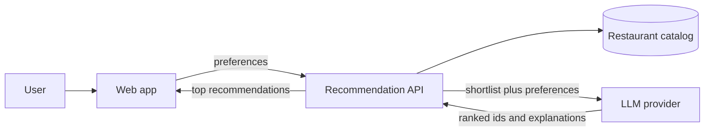
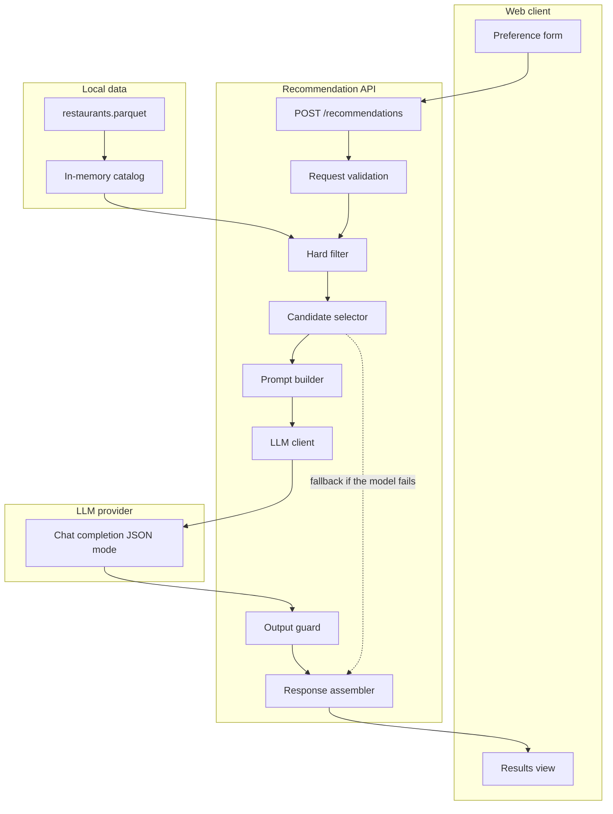
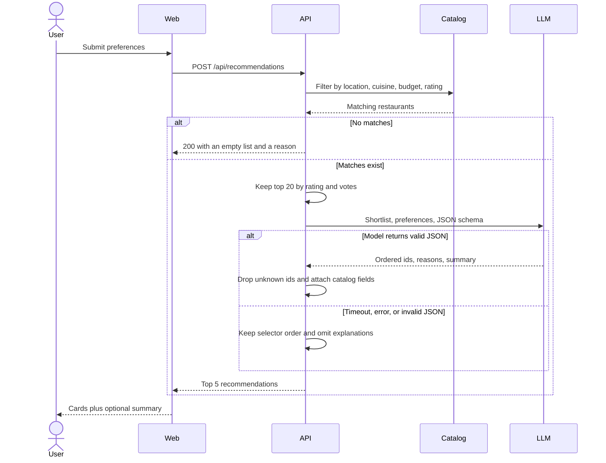

# Architecture

AI-powered restaurant recommendation service. Structured filters narrow a real Zomato catalog, then a large language model ranks the shortlist and explains each choice.

This document is the build plan for the workflow in [problemStatement.md](problemStatement.md).

## 1. Goals

The application must:

- Accept location, budget, cuisine, minimum rating, and free-text preferences such as “family-friendly” or “quick service”.
- Search the Hugging Face dataset [ManikaSaini/zomato-restaurant-recommendation](https://huggingface.co/datasets/ManikaSaini/zomato-restaurant-recommendation).
- Return a short ranked list. Each item shows restaurant name, cuisine, rating, estimated cost, and a written reason it fits.
- Optionally return a short summary of the set.

## 2. Constraints that shape the design

The catalog is about 51,700 rows and 17 columns, and it covers restaurants in Bengaluru. `location` is a neighborhood (Banashankari, Koramangala, Indiranagar), not a city. The problem statement’s “Delhi, Bangalore” examples are illustrative. The location control must be populated from distinct `location` values in this dataset. Promising other cities would return empty results.

The same restaurant appears on multiple rows because Zomato lists it under more than one `listed_in(type)` and `listed_in(city)`. Ingestion must collapse those rows before search.

Several fields the product needs are not clean:

| Source column | Issue | What the app needs |
| --- | --- | --- |
| `rate` | Strings such as `4.1/5`, plus `NEW`, `-`, and blanks | Float from 0 to 5, or null |
| `approx_cost(for two people)` | Strings with commas, some missing | Integer cost for two, or null |
| `cuisines` | Comma-separated, sometimes null | Normalized cuisine tokens |
| `reviews_list` | Stringified list of `(rating, text)` tuples, often huge | Not stored in full. Used only if a later enrichment step needs review snippets |
| `name` + `address` | Duplicated across listing types | One restaurant record |

“Family-friendly” and “quick service” are not columns. Quick service can be inferred from `rest_type` (for example Quick Bites) and `listed_in(type)`. Family-friendly and other free-text preferences are soft signals for the model, not hard filters.

## 3. Design principles

1. **Filter before the model.** Never send the catalog to the LLM. Hard constraints (location, budget, cuisine, minimum rating) run in application code. The model only sees a capped shortlist.
2. **The catalog is the source of truth.** The model returns restaurant ids, a rank, and an explanation. Name, cuisine, rating, and cost are filled from the catalog on the server. The client never trusts model-generated facts.
3. **Structured output.** The model must return JSON that matches a fixed schema. Invalid ids are dropped. If the call fails, the API still returns the shortlist ranked by rating and votes, with explanations omitted.
4. **One in-process catalog.** Fifty thousand deduplicated restaurants fit in memory. No database is required for the first version.
5. **Provider-agnostic LLM calls.** Prompt construction and parsing sit behind an interface so the model vendor can change without touching filtering or the UI.

## 4. System context



Hugging Face is a build-time dependency. A prepare script downloads the dataset once and writes a local catalog. Request handling does not call Hugging Face.

## 5. Runtime components



| Component | Responsibility |
| --- | --- |
| Preference form | Collects location, budget, cuisine, minimum rating, and optional free text. Location and cuisine options come from the API so they stay in sync with the catalog. |
| Request validation | Rejects unknown locations, empty cuisine lists, ratings outside 0–5, and oversized free text. |
| Hard filter | Applies location, cuisine, budget band, and minimum rating. Drops rows with a null rating when a minimum is set, and null cost when a budget is set. |
| Candidate selector | Sorts survivors by rating, then votes. Keeps at most 20. Fewer than 20 is valid. Zero survivors returns an empty result without calling the model. |
| Prompt builder | Serializes the shortlist as compact records (id, name, cuisines, rating, votes, cost for two, rest type, liked dishes) plus the user’s soft preferences. |
| LLM client | Sends the prompt with a JSON response schema and a timeout. Reads the API key from the environment. |
| Output guard | Parses JSON, keeps only ids that were in the shortlist, caps the list at 5, and preserves catalog fields. |
| Response assembler | Builds the payload the UI renders, including an optional one-paragraph summary from the model. |

## 6. Request lifecycle



Target latency for a warm server is under a few seconds, dominated by the model call. Filtering this catalog is milliseconds.

## 7. Data architecture

### 7.1 Ingestion

`scripts/prepare_dataset.py` runs offline:

1. Load `ManikaSaini/zomato-restaurant-recommendation` with the Hugging Face `datasets` library.
2. Parse `rate` into `rating`. Treat `NEW`, `-`, and blanks as null.
3. Parse `approx_cost(for two people)` into `cost_for_two` by stripping commas. Non-numeric values become null.
4. Split `cuisines` on commas, trim, and lowercase for matching. Keep a display string with original casing.
5. Normalize `online_order` and `book_table` to booleans.
6. Deduplicate on `name` + `address`. Keep the row with the most votes. Union cuisine tokens and `listed_in(type)` values across duplicates.
7. Assign a stable `id` (hash of name + address) so prompt ids survive regenerating the file only when the source row is unchanged.
8. Write `data/restaurants.parquet` and a small `data/facets.json` of sorted locations and cuisines for the form.

Columns kept in the catalog:

| Field | Use |
| --- | --- |
| `id` | Identity in prompts and API responses |
| `name` | Display |
| `address` | Dedup key; available for a detail line |
| `location` | Hard filter and display |
| `cuisines` | Display string |
| `cuisine_tokens` | Hard filter |
| `rating` | Hard filter, sort, display |
| `votes` | Sort tie-break; a proxy for how established the rating is |
| `cost_for_two` | Budget filter and display |
| `rest_type` | Passed to the model; supports “quick service” |
| `listed_types` | Passed to the model (Delivery, Dine-out, Cafes, and so on) |
| `dish_liked` | Passed to the model when present, truncated |
| `online_order` | Optional display |
| `book_table` | Optional display |
| `url` | Optional outbound link |

`reviews_list`, `menu_item`, and `phone` stay out of the runtime catalog. Reviews dominate row size and are not required to meet the problem statement.

### 7.2 Budget bands

Budget is a label. The server maps it to `cost_for_two` in Indian rupees. Bands live in configuration so they can be tuned after looking at the cost distribution:

| Budget | Cost for two |
| --- | --- |
| low | under 500 |
| medium | 500 to 1,000 inclusive |
| high | above 1,000 |

### 7.3 Loading

On startup the API reads the parquet file into a list of restaurant objects and builds:

- A location → restaurants map
- A cuisine token → restaurants map

The first filter step is an intersection of those posting lists, then a linear pass for budget and rating. That is enough at this size. If startup must stay fast in development, the process can lazy-load on the first request.

Regenerating the parquet is a manual or CI step, not part of a user request.

## 8. Recommendation engine

### 8.1 What is hard vs soft

| Preference | Enforcement |
| --- | --- |
| Location | Hard. Exact match on normalized `location`. |
| Cuisine | Hard. A restaurant matches if any selected cuisine is in `cuisine_tokens`. Multiple selections are OR. |
| Budget | Hard. Inclusive band on `cost_for_two`. |
| Minimum rating | Hard. `rating >= minimum`. |
| Additional text | Soft. Included in the prompt. The selector does not keyword-filter it, because phrases like “family-friendly” rarely appear as exact column values. |

### 8.2 Candidate cap

Twenty candidates bound prompt size and cost. Sort key:

1. `rating` descending
2. `votes` descending
3. `name` ascending, so ties are stable

The response shows at most five restaurants. Asking the model to order twenty and then taking five gives it room to prefer a slightly lower-rated place that matches the free-text preference.

### 8.3 Prompt contract

System instructions tell the model to:

- Recommend only from the supplied restaurants, referenced by `id`.
- Rank for the user’s soft preferences while treating rating and cost as already satisfied.
- Explain each pick in two or three sentences, citing concrete fields (cuisine, cost, rest type, liked dishes), not invented dishes, reviews, or awards.
- Return a short summary of the set, or an empty string.
- Respond with JSON only.

User message content:

- The structured preferences
- The additional free-text preference, or “none”
- The shortlist as a JSON array

Response schema:

```json
{
  "summary": "string",
  "recommendations": [
    {
      "id": "string",
      "reason": "string"
    }
  ]
}
```

Temperature stays low (around 0.2) so repeated queries with the same input stay similar.

### 8.4 Guardrails

- Unknown ids are discarded.
- Duplicate ids are discarded.
- Reasons are length-capped before they reach the client.
- If every id is invalid, fall back to selector order and omit reasons.
- The model is not given phone numbers or full reviews.

### 8.5 Fallback ranking

Used when the provider errors, times out, or returns unparseable output:

- Order remains the selector order.
- `reason` is null.
- `summary` explains that explanations are temporarily unavailable.
- The HTTP status is still 200. The payload includes `"explanations": "unavailable"` so the UI can say so. A provider outage should not look like “no restaurants matched”.

## 9. API

Base path `/api`. JSON in and out.

### `GET /api/health`

Returns process status and whether the catalog is loaded, including restaurant count.

### `GET /api/facets`

Returns form options derived from the catalog:

```json
{
  "locations": ["Banashankari", "Koramangala 5th Block"],
  "cuisines": ["chinese", "north indian"],
  "budgets": ["low", "medium", "high"],
  "ratingMin": 0,
  "ratingMax": 5
}
```

Cuisine labels can be title-cased in the UI. Filter values stay lowercase.

### `POST /api/recommendations`

Request:

```json
{
  "location": "Banashankari",
  "budget": "medium",
  "cuisines": ["north indian"],
  "minRating": 4.0,
  "preferences": "family-friendly, not too loud",
  "limit": 5
}
```

`preferences` is optional, max 500 characters. `limit` defaults to 5 and cannot exceed 5.

Success:

```json
{
  "summary": "Two casual dining rooms and one cafe match a family meal in Banashankari.",
  "explanations": "available",
  "matchedCount": 37,
  "recommendations": [
    {
      "id": "8f3a…",
      "name": "Jalsa",
      "cuisines": "North Indian, Mughlai, Chinese",
      "location": "Banashankari",
      "rating": 4.1,
      "votes": 775,
      "costForTwo": 800,
      "restType": "Casual Dining",
      "reason": "Rated 4.1 with a cost for two inside your medium budget, and the menu mixes North Indian and Chinese."
    }
  ]
}
```

Empty match (`200`):

```json
{
  "summary": "No restaurants in Banashankari match those filters.",
  "explanations": "skipped",
  "matchedCount": 0,
  "recommendations": []
}
```

Errors:

| Status | When |
| --- | --- |
| 422 | Unknown location, unknown budget, rating out of range, or no cuisine selected |
| 500 | Catalog failed to load |

## 10. Web client

A single page is enough.

**Form**

- Location: searchable select from `GET /api/facets`
- Budget: three options, default medium
- Cuisine: multi-select, at least one required
- Minimum rating: slider or select from 0 to 5 in 0.5 steps, default 3.5
- Additional preferences: optional textarea
- Submit button with a pending state while the request runs

**Results**

- Summary paragraph when present
- A card per recommendation with name, cuisine, rating, cost for two, location, and the explanation
- Empty state that names which filters returned nothing and suggests relaxing rating or budget
- A distinct note when `explanations` is `unavailable`, so cards still show catalog facts

The client does not rank or call the model. It only renders the API payload.

## 11. Suggested repository layout

```text
backend/
  app/
    main.py                 # FastAPI app, catalog startup
    api/
      facets.py
      recommendations.py
    schemas/
      request.py
      response.py
      llm.py
    services/
      catalog.py            # load parquet, indexes, lookup by id
      filter.py             # hard filters
      select.py             # top-20 sort
      recommend.py          # orchestrates filter, select, LLM, guard
      llm_client.py         # provider call and timeout
      prompt.py
    config.py               # bands, caps, model name, timeouts
  scripts/
    prepare_dataset.py
  tests/
    test_filter.py
    test_guard.py
    test_recommend_fallback.py
  data/                     # generated, not committed if large
frontend/
  src/
    App.tsx
    api.ts
    components/PreferenceForm.tsx
    components/Results.tsx
docs/
  problemStatement.md
  architecture.md
```

## 12. Technology choices

| Concern | Choice | Why |
| --- | --- | --- |
| API | Python 3.11+ and FastAPI | Fits dataset tooling and a typed JSON API |
| Catalog prep | `datasets` + pandas, output parquet | One-time clean of the Hugging Face file |
| Runtime data | pyarrow, in-memory indexes | No database to operate at this volume |
| Validation | Pydantic | Same models for HTTP and the LLM schema |
| LLM | Chat completions with JSON schema, model name in env (`LLM_MODEL`) | Keeps the vendor out of the filter code. A small model is enough for ranking a shortlist of 20 |
| Web | React + Vite | Simple form and card layout |
| Config | Environment variables | `LLM_API_KEY`, `LLM_BASE_URL`, `LLM_MODEL`, `CATALOG_PATH` |

`LLM_BASE_URL` defaults to an OpenAI-compatible endpoint so a local model server can be used in development.

## 13. Configuration

| Variable | Required | Purpose |
| --- | --- | --- |
| `LLM_API_KEY` | Yes, for explanations | Provider credential. Never committed or sent to the browser |
| `LLM_BASE_URL` | No | Override for a compatible endpoint |
| `LLM_MODEL` | No | Model id. Default to a small, cheap chat model |
| `CATALOG_PATH` | No | Path to `restaurants.parquet` |
| `LLM_TIMEOUT_SECONDS` | No | Default 20 |

Budget thresholds and the candidate cap (`20`) and result cap (`5`) live in `config.py`.

## 14. Failure behavior

| Failure | Behavior |
| --- | --- |
| Catalog file missing at startup | Process fails fast with a log line that points at `prepare_dataset.py` |
| Zero restaurants after filters | 200, empty list, no model call |
| Model timeout or HTTP error | 200, selector order, `explanations: unavailable` |
| Model returns extra restaurants or prose | Guard drops unknown ids. Unparseable body uses the fallback |
| Facets requested before catalog load | 503 |

Log the model latency, token usage if the provider returns it, and whether the fallback ran. Do not log the API key or the full prompt in production info logs.

## 15. Testing

- **Filter unit tests.** Rating parse, cost parse, dedup, budget edges (499, 500, 1000, 1001), cuisine OR, null rating excluded when a minimum is set.
- **Guard unit tests.** Unknown ids dropped, duplicates dropped, catalog fields overwrite anything the model echoed, all-invalid falls back.
- **Orchestration test with a fake LLM client.** Assert the prompt contains only the 20 ids, and a client exception still returns cards.
- **API test.** 422 on an unknown location. 200 shape for a known fixture catalog of a handful of rows, so tests do not download Hugging Face.

The live provider is not part of the default test run.

## 16. Build order

1. Prepare script and a checked-in tiny fixture that mirrors the real columns.
2. Catalog load, facets, and hard filter. This path is useful before any model key exists.
3. `POST /api/recommendations` with selector order only.
4. LLM client, prompt, and guard, with fallback.
5. Web form and result cards.
6. Empty, error, and “explanations unavailable” states in the UI.

## 17. Out of scope for this version

- Accounts, saved preferences, and personalization across visits
- Live Zomato search, booking, or ordering
- Embeddings or vector search. The catalog is small and the constraints are structured
- Map or geolocation. The dataset has addresses but not reliable coordinates
- Cities outside Bengaluru
- Fine-tuning a model
