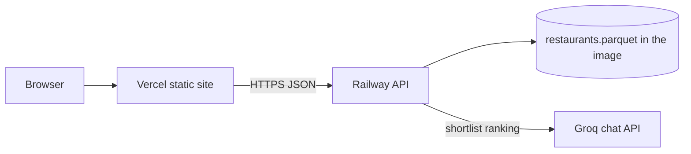
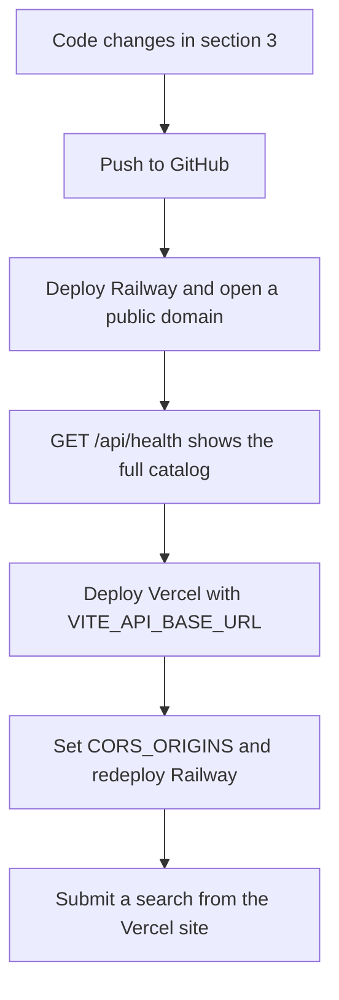

# Deployment Plan

Deploy the recommendation API on Railway and the web client on Vercel. Both services come from this repository. Railway runs the FastAPI process. Vercel serves the Vite build as a static site.

Local development stays unchanged: `uvicorn` on port 8000 and `npm run dev` on port 5173.

## 1. What is deployed



| Piece | Host | Why |
| --- | --- | --- |
| `frontend/` React + Vite app | Vercel | Static build, no server |
| `backend/` FastAPI app | Railway | Long-running Python process, outbound call to Groq |
| `restaurants.parquet` | Inside the Railway image | Loaded into memory at startup. About 3.5 MB |
| Groq | External | `LLM_API_KEY` stays on Railway. The browser never sees it |

Hugging Face is not called at runtime. Prepare the catalog before the image is built.

## 2. Gaps that block a working deploy

The current code runs locally. These four items fail in production if left as they are.

| Gap | Where | What happens if unchanged |
| --- | --- | --- |
| API origin is hardcoded | `frontend/src/api.ts` sets `API_BASE_URL` to `http://127.0.0.1:8000` | The Vercel site calls the visitor’s own machine |
| CORS allows only Vite dev | `backend/app/config.py` `VITE_DEV_ORIGINS` is `localhost:5173` and `127.0.0.1:5173` | The browser blocks every call from the Vercel origin |
| Catalog is gitignored | `.gitignore` ignores `backend/data/restaurants.parquet` | Railway clones the repo, the file is absent, and startup exits |
| Listen address | There is no start command | Railway expects `0.0.0.0` and the `PORT` it injects. Binding only to `127.0.0.1:8000` is unreachable |

`datasets` and `pytest` are in `backend/requirements.txt` for catalog prep and tests. The running API needs FastAPI, Uvicorn, Pydantic, pandas, pyarrow, and httpx. Leaving `datasets` in the install makes the Railway build large and slow. Split it out before the first deploy.

## 3. Code changes before the first deploy

Do these in the repo, then push. Dashboard settings alone cannot fix the hardcoded origin or the missing catalog.

### 3.1 Frontend API base URL

In `frontend/src/api.ts`, read the base URL from Vite’s environment, with the local default kept for `npm run dev`:

```ts
const API_BASE_URL = import.meta.env.VITE_API_BASE_URL ?? "http://127.0.0.1:8000";
```

Vite inlines `VITE_*` variables at **build** time. Changing the Railway URL later requires a new Vercel build. Do not prefix the Groq key with `VITE_`. Anything with that prefix is shipped to the browser.

### 3.2 CORS

Keep the two Vite dev origins. Add production origins from `CORS_ORIGINS`, a comma-separated list:

```text
CORS_ORIGINS=https://your-app.vercel.app
```

Apply that list in `CORSMiddleware` in `backend/app/main.py`. An empty variable should mean “dev origins only”, so local runs need no extra setting.

Vercel preview deployments use a different host on every branch (`https://<project>-git-<branch>-<team>.vercel.app`). Exact strings will not cover them. If previews should call the API, also allow this pattern:

```text
https://.*\.vercel\.app
```

Use `allow_origin_regex` for that pattern. Keep `allow_credentials` only if you still send credentials. This app does not use cookies, so credentials can stay off in production. Do not combine `allow_origins=["*"]` with credentials.

### 3.3 Runtime dependencies and Python version

Add `backend/requirements-dev.txt` for local prep and tests:

```text
-r requirements.txt
datasets
pytest
```

Leave `backend/requirements.txt` as the runtime set only:

```text
fastapi
uvicorn
pydantic
pandas
pyarrow
httpx
```

Pin the interpreter with `runtime.txt` at the repository root and the same file at `backend/runtime.txt`:

```text
python-3.12.15
```

Railpack installs that interpreter with mise. mise refuses `3.12.7` because that python-build-standalone release has no GitHub artifact attestation. `3.12.15` is the current 3.12 build and is attested. Railpack reads `runtime.txt` from the directory it is building. The Railway service builds the repository root, so the root file is the one that selects Python. The copy under `backend/` keeps a backend-only build on the same version.

Put the same runtime package list in the repository-root `requirements.txt`. Railpack detects Python only when `requirements.txt`, `pyproject.toml`, or a root `main.py` is in the directory it analyzes. A `requirements.txt` that merely says `-r backend/requirements.txt` is not enough: the install step copies the root file alone, then `pip` cannot see `backend/requirements.txt`.

### 3.4 Start command

Railpack’s FastAPI default is `uvicorn main:app`, and that file does not exist at the repository root. Set the real command in `railpack.json` and `railway.toml`:

```text
cd backend && uvicorn app.main:app --host 0.0.0.0 --port ${PORT:-8000}
```

`cd backend` makes `app` importable and makes `CATALOG_PATH=data/restaurants.parquet` resolve to `backend/data/restaurants.parquet`.

Also keep `backend/Procfile` for a build whose root directory is `backend/`:

```text
web: uvicorn app.main:app --host 0.0.0.0 --port ${PORT:-8000}
```

`${PORT:-8000}` uses Railway’s port in production and port 8000 when `PORT` is unset.

### 3.5 Ship the catalog

`backend/data/restaurants.parquet` is about 3.5 MB, under GitHub’s file limit. Remove that path from `.gitignore` and commit the file that `python scripts/prepare_dataset.py --source huggingface` already produced locally.

Confirm the file is the full Bengaluru catalog, not the fixture. `GET /api/health` should report a restaurant count in the tens of thousands, not the handful of rows in `backend/data/fixtures/zomato_sample.csv`.

Regenerating the catalog stays a manual step. Commit the new parquet when the source data changes. Do not download Hugging Face during the Railway build.

## 4. Railway — API

Create the service first. The frontend build needs the public API URL.

1. Push the repo to GitHub, including `restaurants.parquet` and the files from section 3. Do not push `backend/.env`.
2. In Railway, create a project and deploy from that GitHub repo.
3. Leave the service **root directory** empty (the repository root). Railpack 0.41 only analyzes that directory. The first build failed with “Railpack could not determine how to build the app” because it saw `backend/`, `frontend/`, and `docs/` and no Python or Node project at `/`. The line `Script start.sh not found` is the shell provider giving up; it is not the app’s start script.
4. Do not set a custom start command in the dashboard. `railway.toml` and `railpack.json` already start Uvicorn from `backend/`. A dashboard start command overrides the file. These root files are what Railpack needs:

   | File | Role |
   | --- | --- |
   | `requirements.txt` | Same runtime packages as `backend/requirements.txt`, so the root is detected as Python |
   | `runtime.txt` | Python 3.12.15 |
   | `railpack.json` | `provider: python` and the Uvicorn start command |
   | `railway.toml` | Same start command, health check `/api/health`, and watch paths limited to the API |

5. Add variables. Names match `backend/.env.example` plus `CORS_ORIGINS`.

   | Variable | Value |
   | --- | --- |
   | `LLM_API_KEY` | Groq key. Set in the dashboard only |
   | `LLM_BASE_URL` | `https://api.groq.com/openai/v1` |
   | `LLM_MODEL` | `openai/gpt-oss-120b` |
   | `LLM_TIMEOUT_SECONDS` | `20` |
   | `CATALOG_PATH` | `data/restaurants.parquet` |
   | `CORS_ORIGINS` | Leave empty until the Vercel URL exists, then set the exact `https://` origin |

   `CATALOG_PATH` is relative to the process working directory. The start command `cd`s into `backend` first, so `data/restaurants.parquet` matches the default in `app/config.py`.

6. Generate a public domain under Networking. Copy the `https://….up.railway.app` URL.
7. `railway.toml` sets the health check path to `/api/health`. The process loads the parquet in the FastAPI lifespan before it serves traffic, so a passing check means the catalog loaded.
8. Give the service at least 1 GB of memory. pandas and pyarrow import cost more than the 3.5 MB file.

Deploy and open `https://<railway-host>/api/health`. A ready service returns:

```json
{ "status": "ok", "catalogLoaded": true, "restaurantCount": <tens of thousands> }
```

`catalogLoaded: false` should not appear: a missing parquet exits the process. A count of a few rows means the fixture was deployed instead of the full catalog.

## 5. Vercel — web client

1. Import the same GitHub repo.
2. Set **Root Directory** to `frontend`.
3. Framework preset: Vite. Build command: `npm run build`. Output directory: `dist`. Install command: `npm install`.
4. Add an environment variable for Production (and Preview, if previews should work):

   | Name | Value |
   | --- | --- |
   | `VITE_API_BASE_URL` | `https://<railway-host>` with no trailing slash and no `/api` suffix |

   `frontend/src/api.ts` appends `/api/facets` and `/api/recommendations`.

5. Deploy. Copy the production URL, for example `https://<project>.vercel.app`.
6. Set Railway `CORS_ORIGINS` to that exact origin, including `https://` and with no path. Redeploy the Railway service so the process picks up the new variable.
7. If a custom domain is added later, append it to `CORS_ORIGINS` and redeploy Railway. Rebuild Vercel only when `VITE_API_BASE_URL` changes.

The app is one page with no client-side router, so Vercel does not need a rewrite to `index.html` beyond the Vite preset.

## 6. Order of operations



CORS can be set to the final Vercel hostname before the first Railway deploy if that hostname is already known. Otherwise use the two-step update above.

## 7. Smoke test

From the deployed site, as a user:

1. The form loads locations and cuisines. That is `GET /api/facets`. A CORS or wrong-base-URL failure shows up here first.
2. Submit a known neighborhood, one cuisine, medium budget, and a minimum rating of 4. Cards return with name, cuisine, rating, and cost.
3. With a valid `LLM_API_KEY`, `explanations` is `available` and cards include a reason. If Groq errors or times out, cards still render and `explanations` is `unavailable`. That is the intended fallback, not a failed deploy.
4. An unknown combination returns an empty list with a summary, HTTP 200.
5. Confirm the browser network panel calls `https://<railway-host>/api/...` and never `127.0.0.1` or `api.groq.com`.

From a terminal:

```text
curl https://<railway-host>/api/health
curl https://<railway-host>/api/facets
```

## 8. Operating notes

| Topic | Behavior |
| --- | --- |
| Cold start | Railway sleeps an idle service on the hobby plan. The next visit waits for process boot and the parquet load, then the Groq call. Expect the first search after idle to be slower than a warm local server. |
| Groq limits | `openai/gpt-oss-120b` on Groq is capped (8,000 tokens per minute, 200,000 per day in `app/config.py`). Over the limit, the API still returns selector order with `explanations: unavailable`. |
| Secrets | `LLM_API_KEY` lives only in Railway variables. `backend/.env` stays local and gitignored. |
| Catalog refresh | Re-run `python scripts/prepare_dataset.py --source huggingface` locally, commit the new parquet, and redeploy Railway. |
| Logs | Railway logs should show restaurant count at startup and model latency. They must not contain the API key. |
| Local dev | No `VITE_API_BASE_URL` and no `CORS_ORIGINS` is a valid local setup. The defaults stay `http://127.0.0.1:8000` and the Vite dev origins. |

## 9. Files this deploy adds

```text
requirements.txt          # same runtime packages, so Railpack detects Python at /
runtime.txt               # Python 3.12.15 for a repository-root build
railpack.json             # provider and Uvicorn start command
railway.toml              # start command, health check, API watch paths
backend/Procfile
backend/runtime.txt
backend/requirements-dev.txt   # datasets and pytest move here
backend/requirements.txt       # runtime packages only
backend/data/restaurants.parquet   # tracked after the gitignore edit
```

Edits to existing files: `frontend/src/api.ts`, `backend/app/config.py`, `backend/app/main.py`, `.gitignore`.
